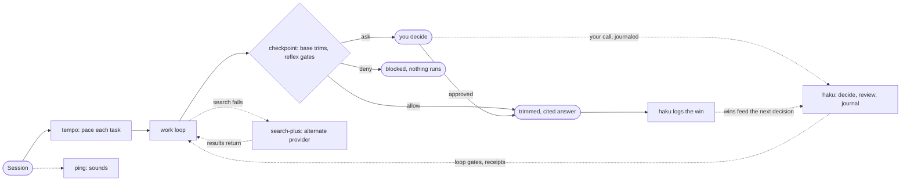

# VibeKit: Productivity Plus Claude Code Plugin Marketplace

Six plugins for Claude Code, each answering one demonstrated friction:
unreliable search, unprincipled decisions, undisciplined output, missed
attention cues, a flat process tax, and unsafe auto mode. Install one, or
install all six; they share one session without overlapping.

## What each plugin gives you

| The friction | Plugin | What you get |
|---|---|---|
| **Research stalls** on 403s, 429s, and regional blocks | 🔍 [search-plus](#search-plus) | Research that survives: 0 to 20% success on blocked sites becomes 95%+, with keyless fallback and no silent failures |
| **Decisions lack receipts** | 📏 [haku](#haku) | Decisions with an audit trail: intent capture, spec pressure-tests, ship review, and a wins journal that compounds |
| **Output needs hygiene** | 🛠️ [base](#base) | A quieter bill and cleaner landings: trimmed test-output tokens, consistent commits, debugging that finds root causes |
| **Long runs pull you out of flow** | 🔔 [ping](#ping) | No more alt-tabbing: four sounds cover session start, your prompt, attention requests, and completion |
| **Process taxes every task equally** | ⏱️ [tempo](#tempo) | Safety only where it pays: risky tasks spend 34% fewer tokens than no process at all; trivial tasks stay at bare speed |
| **Auto mode fires without a second look** | 🛡️ [reflex](#reflex) | Auto mode with a net: secrets denied, destructive commands paused for your call, decided before the command runs |

Every outcome above is measured on benchmarks or backed by real incidents.
The evidence, per plugin, lives in
[docs/ref/plugin-flow.md](docs/ref/plugin-flow.md).

The through-line: **remove the human as the bottleneck**, either by making
the agent self-sufficient (search fallback, quality gates), pacing your
attention (notifications, decision logs), pacing the agent's process to the
task's risk (tempo), or spending the human's attention only where a
calibrated gate says it's actually needed (reflex). All six stay deliberately
low-dependency: search-plus works without API keys, ping needs no services,
haku is process rather than API, tempo is structure rather than
infrastructure, and reflex's local regex fast paths are keyless. Without a
provider key it simply steps aside.

## How six plugins share one session



The wiring behind this diagram, the ownership map, and per-plugin evidence
live in [docs/ref/plugin-flow.md](docs/ref/plugin-flow.md).

## Quick start

```bash
/plugin marketplace add shrwnsan/vibekit-claude-plugins
```

```bash
/plugin
# Browse and install any plugin
```

Search-plus works immediately after install:

```bash
/search-plus "Claude Code plugin documentation"
/search-plus "https://docs.anthropic.com/en/docs/claude-code"
```

## Plugins

### Base

The stuff you stop thinking about. Commits craft themselves with
conventional formatting and attribution, test output trims to tokens,
debugging follows a root-cause method, and branch hygiene keeps worktrees
clean.

```bash
/base:commit            # intelligent commit with co-authorship
/base:commit --fast     # quick path
```

[Details](plugins/base/README.md)

### Search-plus

Research that survives provider failures. Multi-provider fallback across
search (TinyFish, Tavily, Brave, Exa, Jina, keyless Firecrawl) and
extraction (origin markdown, Defuddle, Wayback), with structured failure
detection and no silent "did 0 searches" responses. Measured: 0 to 20%
baseline success on blocked sites rose to 95%+, at roughly 2.3 seconds
average.

```bash
/search-plus "latest React best practices"
/search-plus "https://docs.anthropic.com/en/docs/claude-code"
@search-plus investigate a topic end to end
```

[Details](plugins/search-plus/README.md)

### Ping

Stop watching the terminal. Four sounds cover session start, your prompt,
attention requests, and completion, on macOS, Linux, and Windows. Custom
sounds or nostalgic game audio, configured through one JSON file.

[Details](plugins/ping/README.md)

### Haku

Decisions with receipts that compound. An always-on core of 8 skills and 5
gate agents runs the decide, spec, evidence loop: intent capture, spec
pressure-tests from a red-team gate, ship review, and a wins journal. Eight
opt-in role packs cover product, people, comms, and engineering work.
Licensed CC BY-SA 4.0, vendored from its own upstream at tag `v0.5.0`.

[Details](plugins/haku/README.md)

### Tempo

More safety, fewer tokens, on the tasks that need it. Every task is tiered
0/1/2 by risk: trivial changes load no skills, standard changes get
test-first with a single agent, risky changes get a plan file and a review
gate. Measured on hidden tests, medians of 3 runs: risky tasks spend 0.66x
the tokens of bare Claude Code with parity turns; the process-heavy
reference plugin cost 1.2 to 2.7x tokens at identical correctness on every
tier.

```bash
/tempo:risk-triage      # classify the current task
/tempo:tier-2-risky     # force the risky flow
```

[Details](plugins/tempo/README.md)

### Reflex

Auto mode with a net. Local regex rules instantly allow read-only commands,
ask on secrets and key material, and deny unambiguous destruction;
risky-but-contextual commands go to a decision model (TypeSafe Jev, Liquid
d1, or any compatible endpoint) that returns typed risk probabilities. Fails
safe by construction: provider errors hand the decision back to Claude Code
untouched. Every verdict is logged. Metrics are deliberately unpublished
until real traffic accumulates; thresholds tune against your own usage
through the verdict log.

```bash
/plugin install reflex@vibekit
export TYPESAFE_API_KEY=...   # or LIQUID_API_KEY, or a localhost endpoint
tail -f ~/.local/share/reflex/verdicts.jsonl
```

[Details](plugins/reflex/README.md)

## Community

Issues, feature requests, and feedback all start at
[CONTRIBUTING.md](CONTRIBUTING.md). Plugin authors: the architecture and
conventions live there too. If VibeKit earns it, a star helps other people
find it.

## License

Apache-2.0 across the marketplace, except haku (CC BY-SA 4.0). See LICENSE.
