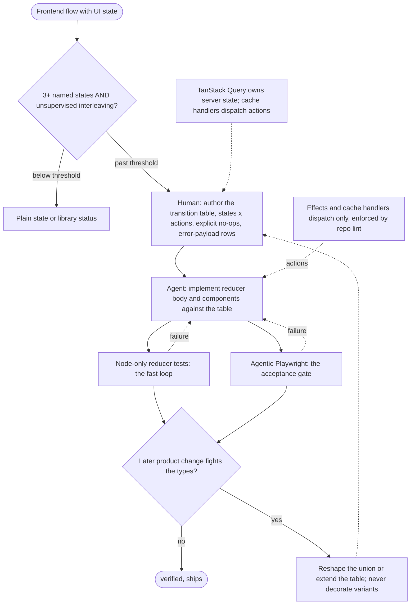
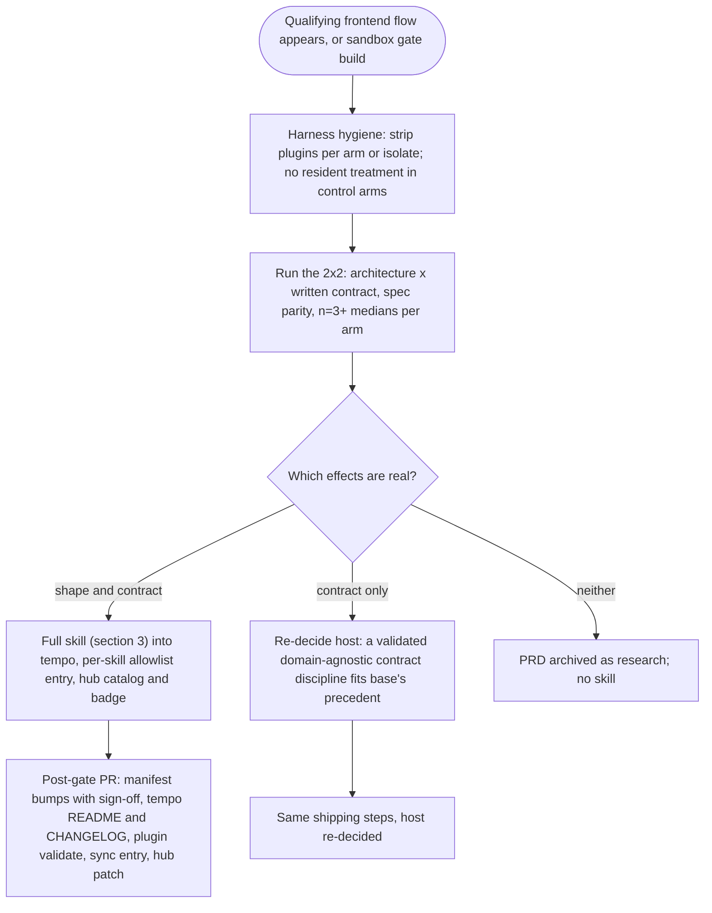

# prd-011: frontend-state-contracts skill

**Tagline:** complexity-earned state contracts for agent-edited frontend code
**Status:** drafted, pre-validation. The skill ships only after the 2x2 gate in section 6 passes.
**Date:** 2026-11-15
**Author:** shrwnsan, drafted with Claude Code (GLM)

## 1. Problem

Agents edit frontend state logic and break transitions silently. When UI state
lives in scattered `useState`/`useEffect` calls, nothing forces an agent to
acknowledge states it did not know could co-occur, verification requires
rendering the app, and invariants that were never written down cannot be
respected. The reference case is Matt Pocock's short "The secret to building
robust frontend apps with agents" (2026-10-16), which claims reducers and state
machines make agent-edited frontend code feel "more robust", and nothing else:
the linked aihero.dev page is an email-course signup, so the 94-second short is
the entire public argument.

A full review (transcript read, three adversarial rounds, an evidence sweep, a
verdict pass, then a placement review with two more adversarial rounds) sits in
the internal research record. Net findings:

- No direct empirical evidence exists, for or against. Adjacent proxies only
  (LLMs degrade on class-level vs function-level tasks; Anthropic and OpenAI
  back code-plus-tests as the agent verify loop but never mention reducers).
- React's own docs are conditional: reducers when many handlers update state in
  many ways.
- The strongest surviving mechanism is the contract, not the shape: much of the
  claimed effect is predicted to come from a human authoring the spec, not from
  the reducer's geometry. This is testable and untested.

## 2. Outcome wanted

| Outcome | Definition |
|---|---|
| Fewer silent transition bugs | Illegal state combinations and missed transitions surface as compile or test failures instead of runtime surprises |
| Cheap agent verify loop | Reducer logic testable in Node, milliseconds, no browser |
| No universal ceremony tax | Simple state stays simple; the protocol applies only past a threshold |
| Evidence before exposure | No hub publication, and no resident skill, until the 2x2 gate passes |

## 3. Proposed solution: the protocol (doubles as the future skill spec)

How a task moves through the discipline, and who owns each step:



<details>
<summary>Plain-text view (terminals and non-rendering clients)</summary>

```text
    frontend flow with UI state
              |
              v
    3+ named states AND unsupervised interleaving?
        | no (below threshold)          | yes (past threshold)
        v                               v
    plain state or          Human authors the transition table
    library status          (states x actions, no-ops, error rows)
                                    |         ^
        TanStack Query owns          |         |  reshape the union or
        server state; cache  -.->    v         |  extend the table; never
        handlers dispatch    Agent implements  |  decorate variants (rot
                              reducer + comps  |  patrol loops back)
                                    |
                    +---------------+----------------+
                    v                                v
        Node-only reducer tests            agentic Playwright
        (the fast loop)                    (the acceptance gate)
                    |                                |
                    + failure loops back to implementation
                    |
                    v
        verified, ships ... until a later product change
        fights the types, which reopens the table
```
</details>

The clauses the flow encodes:

1. **Threshold.** A union plus reducer applies when a UI flow has 3 or more
   named states AND events can interleave in orders the UI did not sequence
   itself (device callbacks, timers, user actions mid-flight, competing
   fetches). Below the threshold: plain state or library status. Server state
   belongs to TanStack Query or equivalent, always; the reducer never owns it.
2. **Contract first.** A human authors the transition table: states x actions,
   explicit no-ops, error-payload rows (permission denied, null blob,
   backgrounded tab). The agent implements the reducer body and components
   against the table. Tests are the spec, written before implementation; an
   agent never authors the table it is graded against.
3. **Dispatch-only effects.** Effects and query-cache handlers dispatch actions;
   a repo-level lint rule enforces this, not convention. Dispatch logs are
   post-hoc observability, not verification.
4. **Rot patrol.** A boolean flag sprouting inside a state variant
   (`{type: 'open', retrying: boolean}`) is the rot signature. Reshape the
   union; never decorate variants.
5. **Two verification layers.** Node-only reducer tests are the fast loop;
   agentic Playwright stays the acceptance gate. The fast loop covers
   transition logic only, which is the part agents break most silently.

## 4. Non-goals

- Not a server-state or data-fetching skill.
- Not a universal rule; the threshold is load-bearing.
- Not base's layer: no commit, branch, or handoff mechanics.
- Ships no lint rules or hooks; enforcement config lives in app repos.
- Not XState advocacy; plain reducers with discipline are the default vehicle.

## 5. Background: origin and ownership

The protocol is inspired by Pocock's short and the wider "agent-friendly
architecture" writing (pure core, harness engineering), then substantially
reshaped by adversarial review: the baseline correction (reducer vs scattered
state, not reducer vs a bug-free world), the interleaving threshold replacing
"anything async", union rot, the golden tautology, and the 2x2 design with spec
parity across arms. Same pattern as systematic-debugging in PR #40: inspired by
outside work, landed as an original citizen with no upstream dependency.

## 6. Validation gate: the 2x2 A/B

Architecture crossed with written contract, spec parity across arms:

| Arm | Architecture | Written contract |
|---|---|---|
| A | union + reducer | human-authored table |
| B | union + reducer | none |
| C | scattered useState | equivalent written invariants |
| D | scattered useState | none |

- **Task:** identical feature-change tasks on the same flow; measure agent edit
  success rate (tests green, no illegal states, task complete). Minimum n=3
  runs per arm, medians compared, matching the repo's release-gate convention.
- **Harness hygiene:** the skill must not be resident in any harness used for
  control arms. Strip plugins per arm or run isolated environments; a control
  arm that can load the treatment via description match is not a control arm.
- **Prediction on record:** the contract effect (A,C > B,D) is larger than the
  shape effect (A,B > C,D).
- **Trigger:** the next qualifying frontend flow in any owned repo, or a
  sandbox build if none appears. No dedicated frontend repo exists today.

## 7. Ship plan (post-gate only)

From trigger to outcome, the whole PRD as one path:



<details>
<summary>Plain-text view (terminals and non-rendering clients)</summary>

```text
    qualifying flow appears (or sandbox build)
              |
              v
    harness hygiene: strip plugins per arm or isolate
    (a control arm that can load the treatment is not a control arm)
              |
              v
    run the 2x2: architecture x written contract
    (spec parity across arms, n=3+ medians)
              |
              v
    which effects are real?
        |                |                 |
        v                v                 v
    shape and       contract only      neither
    contract            |                 |
        |                v                 v
        v         re-decide host     PRD archived
    full skill      (base fits a     as research;
    into tempo,     validated          no skill
    per-skill       domain-agnostic
    sync entry      skill)
        |                |
        +--------+-------+
                 v
    post-gate PR: manifest bumps with sign-off, README and
    CHANGELOG, plugin validate, sync entry, hub catalog patch
```
</details>

| Gate result | Ships |
|---|---|
| Shape and contract both win | Full skill (section 3) into tempo, per-skill sync entry `"tempo/frontend-state-contracts"` plus hub catalog/badge work |
| Contract wins, shape does not | A domain-agnostic "written contract before agent implementation" discipline; re-decide host then (base fits a validated domain-agnostic skill; its plugin-granularity sync is acceptable for validated content) |
| Neither | PRD archived as research; no skill |

Shipping steps in either winning case: SKILL.md under `plugins/tempo/skills/`
(respect tempo's constraints: under ~100 lines, static, no cascade; the
transition-table template goes to `assets/`, not body prose), tempo version bump
in both manifests plus `.claude-plugin/marketplace.json` (Critical Boundaries:
explicit sign-off first), tempo README and CHANGELOG, `claude plugin validate .`,
then the per-skill allowlist entry and hub-side catalog/badge patch in the same
effort. Plugin-level tempo sync stays off; PR #140's lesson stands.

## 8. Open questions

- Size vs fidelity: tempo's corpus is 23-60 line rule cards; this is a
  protocol. Does the ~100-line card plus `assets/` template preserve enough of
  the validated artifact, or does the shipped shadow diverge from the tested
  one? Answer after the gate, against the winning arm's actual document.
- Routing: nothing in tempo's tier table emits "frontend state work". Options:
  a one-line pointer from the tier-2 card, or description-match only. The
  pointer puts the first domain reference inside a domain-agnostic flow; decide
  at ship time.
- Naming: `frontend-state-contracts` clears the known collision (haku's
  `the-reducer` agent) and stays distinctive in shared skill dirs.
- Where the A/B runs, if no qualifying flow appears: sandbox build dedicated to
  the gate.

## 9. Relationship to existing plugins

| Plugin | Relationship |
|---|---|
| base | Unaffected. Rejected as host: whole-plugin sync auto-publishes unvalidated guidance (the packaging flaw), and its "workflow and context engineering" scope has no vacancy for a frontend protocol |
| tempo | Pre-committed host, post-gate only, with a per-skill sync entry (never plugin-level). Not landed now: a resident skill is locally invocable and would contaminate the gate's control arms, and landing now buys nothing a five-minute post-gate PR cannot |
| haku | Unaffected |
| search-plus / ping / reflex | Unaffected |
| shrwnsan/agents hub | Contact only after the gate: catalog row and badge for the new skill, per the sync redesign decision |

## 10. Housekeeping found during this research

- `AGENTS.md` lines on tempo still claim skills-hub publication and a sync
  allowlist entry; both were removed by PR #140. Corrected in the same commit
  as this PRD.
- `plugins/base/README.md` footer still says version 1.12.0 while the manifests
  say 1.12.4. Left for the next base change; noted here so it is not lost.
