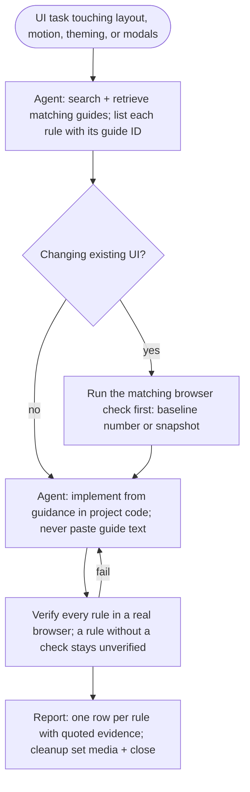

# prd-012: modern-web-guidance skill

**Tagline:** Chrome's Modern Web Guidance, applied to code and proven in a real browser
**Status:** drafted, pre-validation. The skill ships only after the 2x2 gate in section 6 passes.
**Date:** 2026-11-18
**Author:** drafted for shrwnsan, prepared with pi (GLM)

## 1. Problem

Agents apply frontend best practices as prose and never check the result.
When an agent "adds dark mode", "fixes layout shift", or "respects reduced
motion", the change is judged by reading the diff, not by loading the page.
Three specific failure shapes survive code review:

- **Measured, not asserted, behavior.** CLS is a number. A `width` attribute
  on an `` looks right in the diff and still ships 0.23 CLS. Reduced
  motion that "looks respectful" is identical CSS under both preferences.
- **Platform semantics agents under-use.** Native `<dialog>` with
  `showModal()` gives inertness, initial focus, Esc dismissal, and focus
  return for free; hand-rolled modals get each of these wrong in a different
  way, and no diff review catches a background link that is still clickable.
- **Stale guidance.** Model memory of "best practices" predates Baseline
  availability of `popover`, `@starting-style`, View Transitions, and
  `color-scheme`. The agent modernizes toward patterns the platform has since
  replaced.

Upstream target: the `modern-web-guidance` skill in
[vercel-labs/agent-browser](https://github.com/vercel-labs/agent-browser)
(`skill-data/modern-web-guidance/SKILL.md`), announced 2026-11-17 by Chris
Tate (Vercel Labs). It wraps two keyless tools: Chrome's Modern Web Guidance
CLI (`npx modern-web-guidance@latest`: search, retrieve, legacy-scan) and
agent-browser (vitals, `set media`, snapshot, eval, record). The upstream
skill is a workflow, not a study: no evidence exists that the
apply-then-verify loop changes outcomes versus guidance-without-verification.
That is the claim this PRD puts under test.

## 2. Outcome wanted

| Outcome | Definition |
|---|---|
| Violations caught before ship | Seeded CLS, reduced-motion, color-scheme, and dialog-focus defects surface as failed checks with recorded evidence, not silent merges |
| Numbers, not adjectives | Reports carry metric deltas (CLS 0.23 to 0) and computed-style diffs per rule, one row per rule applied |
| No ceremony tax on non-UI work | Skill triggers only on frontend flows touching layout, motion, theming, or modal behavior |
| Keyless by default | MWG CLI via npx, agent-browser against local headless Chrome; no API keys, no services |
| Graceful step-down | No agent-browser on PATH means legacy-scan-only mode, stated plainly; recordings without ffmpeg are skipped with a note, never faked |

## 3. Proposed solution: the loop (doubles as the skill spec)

How a task moves through the discipline, and who owns each step:



<details>
<summary>Plain-text view (terminals and non-rendering clients)</summary>

```text
    UI task touching layout / motion / theming / modals
              |
              v
    search + retrieve guides; list rules with guide IDs
              |
      changing existing UI? -- yes --> baseline check (number/snapshot)
              | no                          |
              v                             v
        implement from guidance <---------- |
              |
        verify every rule in-browser <-- failure loops back
              |
        report: rule x check x result x evidence
        cleanup: set media; close
```
</details>

The clauses the loop encodes:

1. **Guidance before code.** Rules come from retrieved guides with IDs, not
   from model memory. The report cites guide IDs so a reviewer can retrieve
   the same text. `legacy-scan` finds replaceable legacy patterns in existing
   source; empty scan output means nothing, and the skill says so.
2. **Baseline before edit.** For existing UI, the matching check runs first.
   Pass/fail is a delta against the baseline, never an absolute vibe.
3. **Evidence per rule.** CLS via `vitals` (pass at 0.1 or below *and* below
   baseline), computed styles read under both media preferences, dialog
   behavior via interactive snapshot plus `document.activeElement` checks.
   Identical values under both preferences are the classic failure signature.
4. **Recorded perception.** Computed styles do not show what a user sees;
   motion changes record under both preferences when ffmpeg is available.
5. **Honest report.** One row per rule; unverified rules are marked with the
   reason. A rule is never reported passing because the code follows the
   guide.

**Tooling boundary with prd-011** (if both land): frontend-state-contracts'
acceptance gate stays agentic Playwright, the repo's test artifact. MWG is
the platform-guidance evidence layer on top: vitals, computed-style diffs,
and inertness snapshots that Playwright fixtures do not naturally cover. One
frontend flow can run both; neither replaces the other.

## 4. Non-goals

- Not a general QA or E2E skill; coverage is scoped to the MWG guide corpus
  (33 guides in CLI 1.0.0) plus the browser checks upstream defines.
- Not a design-taste skill; art direction stays with the design cluster.
  MWG verifies platform behavior, not aesthetics.
- Not a state-logic skill; transition correctness is prd-011's territory.
- Ships no hooks or lint rules; the loop is invoked on qualifying UI work.
- Not agent-browser advocacy for its own sake; where a repo already has a
  Playwright check for the same rule, that check is the evidence.

## 5. Background: origin and ownership

Upstream is an adopted workflow skill (MIT, vercel-labs/agent-browser),
pinned at the vendoring commit, with provenance recorded. Unlike
systematic-debugging (PR #40) and prd-011, this is not an original citizen:
the methodology is upstream's, and the port contributes Claude Code
frontmatter adaptation, the step-down clause, and the evidence gate.

Placement follows the outcome recorded in PR #162: tempo hosts post-gate via
a per-skill sync entry, never plugin-level, and this skill's gate is
independent of prd-011's. Landing one says nothing about the other; their
README entries state each status separately. This skill does not ride the
contracts gate, and the contracts skill does not wait on this one.

## 6. Validation gate: the 2x2 A/B

Guidance retrieval crossed with browser verification, spec parity across
arms. The prediction under test: verification, not guidance retrieval, is
what changes outcomes.

| Arm | Guidance retrieved | Browser verification |
|---|---|---|
| A | yes (search + retrieve) | yes (the full loop) |
| B | yes | none (rules applied from guide text alone) |
| C | no (model-memory best practices) | yes (verify whatever was built) |
| D | no | none (the baseline status quo) |

- **Fixture:** one sandbox page with four seeded defects, one per upstream
  check family: unreserved image/embed space (CLS), animation ignoring
  `prefers-reduced-motion`, broken dark-mode contrast or missing
  `color-scheme`, and a hand-rolled modal with a focus or inertness bug.
  Defect severities chosen so each is plausible in real review, not
  straw-sized.
- **Task:** identical prompt per arm: "modernize this page" (or the seeded
  defect list withheld; arms see the same starting state). Measure: defects
  fixed (verified by the harness's own checks, not the agent's report),
  false passes (agent claims a fix the browser refutes), tokens, wall time.
  Minimum n=3 runs per arm, medians compared, per the release-gate
  convention.
- **Harness hygiene:** the skill must not be resident in any harness used
  for control arms B, C, D. Plugins stripped per arm or isolated
  environments; a control arm that can load the treatment via description
  match is not a control arm. Arms B and C get the MWG CLI availability
  stated in their prompt so retrieval differences are not access differences.
- **Prediction on record:** the verification effect (A,C > B,D) is larger
  than the guidance-retrieval effect (A,B > C,D). Secondary prediction: B
  produces the most false passes, because guide text without a browser is
  exactly the prose-judgment failure the skill exists to close.
- **Trigger:** the gate runs in the sandbox fixture; no owned frontend repo
  needs to qualify first. Post-gate, a real-flow confirm pass (one genuine
  UI task in an owned repo, full loop, report reviewed) precedes the tempo
  landing.

## 7. Ship plan (post-gate only)

From gate readout to tempo residency:

1. Readout lands in `docs/evals/` with per-arm transcripts and the fixture
   harness, whatever the result. A null or negative result kills the port
   and the fixture becomes the record of why.
2. On a pass: vendor `skill-data/modern-web-guidance` at the pinned commit
   with PROVENANCE, apply the Claude Code frontmatter adaptation and the
   step-down clause, add the plugin README entry in tempo's table voice
   (friction: "UI changes ship unverified against platform best practices";
   what you get: "every rule with a number and a recording").
3. Real-flow confirm pass, then the per-skill sync entry in
   `.github/sync-skills.json`; no plugin version bump per the release-train
   rule.
4. prd-011 dependency: none. Whichever gate reads out second joins the other
   in tempo; the frontend pair ships as two independently evidenced skills,
   not one bundled claim.
