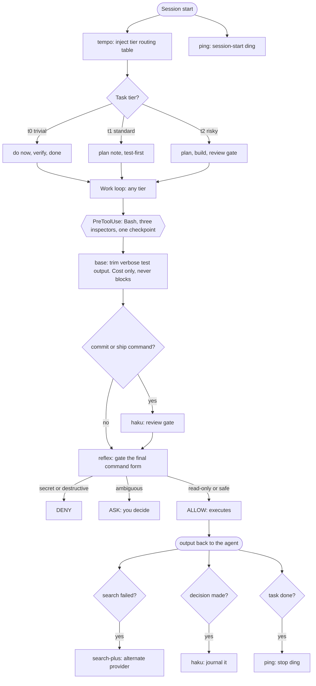

# Plugin flow and value map

Verified against each plugin's hooks.json on 14 Nov 2026. This page shows
where every plugin touches a session, who decides what, and the concrete
benefit each one delivers. The main README carries a simplified birds-eye
view of this diagram, one node per plugin; this page is the verified wiring
reference. Companion to the friction table in the main README.

## The flow

Three plugins share the `PreToolUse: Bash` checkpoint. They run in
marketplace order (base, then haku, then reflex), and any of them can block
the command. Treat them as three inspectors at one checkpoint rather than a
pipeline: the verdicts are independent, and reflex evaluating last means it
judges the final, cost-trimmed command form.



<details>
<summary>Plain-text view (terminals and non-rendering clients)</summary>

```text
                        SESSION START
                              |
            +-----------------+------------------+
            v                                    v
      + tempo ---+                         + ping --+
      | injects  |                         |  ding  |
      | tier     |                        +--------+
      | table    |
      +----+-----+   "which tier is this task?"
           |
   +-------+--------------------------------+
   | t0: trivial      -> do now, verify, done
   | t1: standard     -> note, test-first
   | t2: risky        -> plan, build, review
   +-------+--------------------------------+
           |            WORK LOOP (any tier)
           v
   ====== PreToolUse: Bash ======
   ====== three inspectors, one checkpoint ======
           |
           v
   + base (trim) ---------------------------+
   | test command? -> trim verbose output   |  (cost only, never blocks)
   +--------------+-------------------------+
                  v
   + haku (ship-check) ---------------------+
   | commit or ship command? -> review gate |
   +--------------+-------------------------+
                  v
   + reflex (gate) -------------------------+
   | secret or destructive? -> DENY         |
   | ambiguous?          -> ASK (you decide)|
   | read-only or safe?  -> ALLOW           |
   +--------------+-------------------------+
                  v
              EXECUTES -> output back to the agent
                  |
     +------------+------------------+
     v            v                  v
 search fails?  decision made?   task done?
     |            |                  |
     v            v                  v
 search-plus   haku journal      ping ding
 fallback      (capture/log)     (Stop hook)
     |            |
     +-> retry via alternate provider, log the win
```
</details>

## Who owns what

| Plugin | Decides | Never does |
|---|---|---|
| reflex | whether a command runs at all | what the command costs |
| base | what lands, and what running it costs | how much process a task earns |
| tempo | how much process a task earns | any execution-time decision |
| haku | what gets journaled, reviewed, and loop-gated. With its loop enabled, haku spans the session: decision capture at task start, spec pressure-tests during work, a ship review at the checkpoint, and wins-log after | safety verdicts |
| search-plus | how research recovers from failure | any gate decision |
| ping | nothing. It notifies | anything |

## What you get, per plugin

The main README's table frames each plugin as the answer to a friction. The
same facts reversed read as the benefit you keep. Evidence grade per line:
measured, incident-backed, or cheap and isolated.

- **search-plus** keeps research alive when providers fail. A measured
  baseline of 0 to 20% success on blocked sites rose to 95%+ with multi-provider
  fallback that works keyless. (incident-backed: rate limits and regional
  blocks hit real research sessions)
- **tempo** paces process to risk, so discipline stops being a flat tax.
  Risky tasks spend 34% fewer tokens than no process at all, and trivial
  tasks stay at bare speed. (measured on the ceremony harness, 75 of 75
  tasks passed hidden verification)
- **base** trims the bill and guards what lands. Test output filtering cuts
  token burn on every run, and its skills now cover verification scripts
  that lie and launches that run away. (incident-backed: both failure
  classes surfaced in real work)
- **reflex** makes reduced-supervision safe. Secrets are denied, destructive
  or ambiguous commands pause for your call, and the decision lands before
  the command runs. (incident-backed: an unattended cleanup script once
  wrote 77 GB of debug trace; this is that failure class, caught at launch)
- **ping** ends the alt-tab. Four sounds cover session start, your prompt,
  attention requests, and completion. (cheap and isolated)
- **haku** keeps the receipts. Significant decisions land in a journal you
  can audit instead of living in scrollback. (cheap and isolated)

## No overlap, by construction

The three `PreToolUse: Bash` hooks share a checkpoint, not a job. reflex
makes the safety verdict, base trims cost, haku gates releases. tempo only
writes at session start. search-plus only reacts to search tool calls.
ping only plays sounds. No plugin makes a decision another plugin also
makes, and uninstalling any one leaves the others intact.
